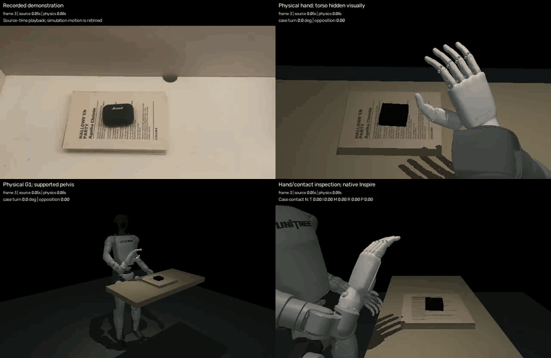

# Video-Guided Dexterous Manipulation

Drive a supported Unitree G1 with a native Inspire five-finger right hand from a
recorded tabletop demonstration. The Book5 example includes the initial hand
turn, grasp, transport, in-hand turn, placement, release and final wrist/finger gestures.
Execution uses MuJoCo motor controls and contact feedback. No policy is trained.

[](examples/video-to-g1/comparison.mp4)

Clockwise from top left: recording, simulated phone view, contact view and G1.
Playback follows source time; the 12.5-second recording is retimed to 70.4 seconds
of simulation. The phone view hides the torso visually; collisions remain active.
[Full-quality comparison](examples/video-to-g1/comparison.mp4) ·
[Source recording](examples/source-recording/book5.mp4) ·
[Steps, methods, results and limitations](docs/full-sequence.md)

| Nominal check | Result |
|---|---|
| Source timeline | All 748 frames retained |
| Initial palm orientation | Mean error 0.79° against extracted estimates |
| Physical case turn | 120.0°; opposing contact retained throughout scored carry |
| Final placement | 2.8 mm from the adapted target; released and stationary |

This is a complete, task-specific motion adaptation. It is not exact video
reconstruction or a fully automatic converter for arbitrary recordings. Phase
boundaries are reviewed annotations; workspace, clearance and timing are adapted
to the robot. Mass, friction and occluded object poses remain uncertain.

## Run

Apple Silicon macOS, Python 3.12, Git, uv and FFmpeg. The saved-input pipeline
runs on CPU without MANO files, neural weights or a GPU.

```bash
git clone https://github.com/Dharun235/video-guided-dexterous-manipulation.git
cd video-guided-dexterous-manipulation
make setup
make test
make video OUTPUT=runs/video-01
```

The command builds the measured scene, fits arm/hand/waist commands, executes
physics, scores the result and independently checks motor-command replay. Use a
new output folder for each attempt. To also render the comparison:

```bash
.venv-g1/bin/python -m video_g1.run_video --output runs/video-02 --render
```

## Method

| Stage | Implementation |
|---|---|
| Human observations | FastHaMeR/MANO hand estimates; raw gaps retained |
| Scene and object inputs | TAA-derived reconstruction inputs and TrackCraft3R pose candidates; measured box collision geometry and book texture |
| Motion planning | Native hand retargeting, RH56 grasp geometry, arm/waist IK, reviewed task phases and explicit retiming |
| Physical execution | Position motors, robot-only bias compensation, external-contact grasp confirmation and force stop |
| Verification | Full-timeline pose/contact/placement metrics, numerical replay, sensitivity checks and CI |

## Status

- [x] Publish the iPhone recording and collection note.
- [x] Preserve initial gestures and the complete source timeline.
- [x] Grasp, carry, turn, place and release a free case through physical contact.
- [x] Save joint states, commands, forces and comparison views.
- [x] Check fresh-run replay, small position changes, tests and CI.
- [ ] Validate uncertain monocular object poses against independent measurements.
- [ ] Establish broader reliability on new recordings and physical parameters.

## Guides and credits

[Complete current pipeline](docs/full-sequence.md) ·
[New hand observations](docs/running.md) · [Scene inputs](docs/taa.md) ·
[Object tracking](docs/object-motion.md) · [Grasp evaluation](examples/rh56-evaluation/README.md)

Built on [RH56 controller](https://github.com/correlllab/rh56_controller),
[TAA](https://github.com/brains-bots-n-behavior/track-articulate-act),
[TrackCraft3R](https://github.com/cvlab-kaist/TrackCraft3r),
[FastHaMeR](https://github.com/VimalMollyn/fasterhamer),
[humanoid-dexart-retarget](https://github.com/gtziafas/humanoid-dexart-retarget)
and [MuJoCo](https://github.com/google-deepmind/mujoco), with Unitree G1/Inspire assets.
[Full credits](docs/acknowledgements.md) · [Third-party notices](THIRD_PARTY_NOTICES.md)
