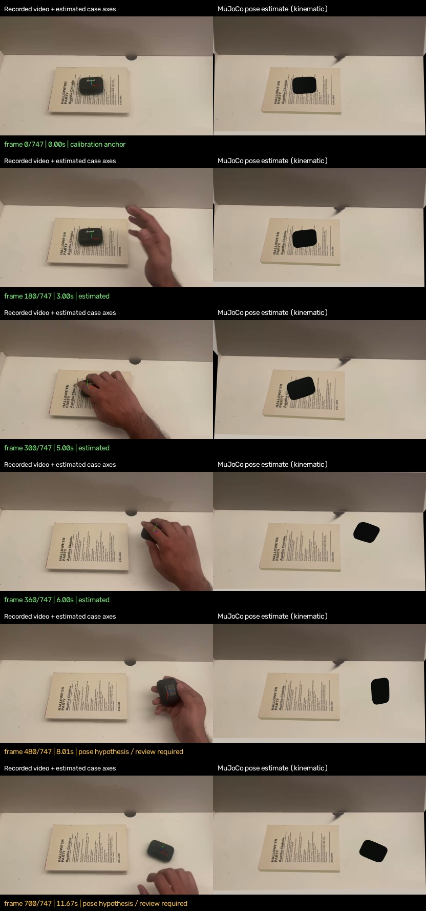

# Video-Guided Dexterous Manipulation

Transfer a recorded tabletop hand demonstration to a Unitree G1 with an Inspire
five-finger right hand. The pipeline estimates human and object motion, builds a
MuJoCo scene and fits robot joint targets. Physical grasp execution is in progress.

## Demo

| Recorded demonstration | Estimated case motion in MuJoCo |
|---|---|
| [](examples/source-recording/book5.mp4) | [](examples/object-motion/object-motion.mp4) |

[Source video](examples/source-recording/book5.mp4) ·
[Hand extraction](examples/hand-extraction/README.md) ·
[Case motion video](examples/object-motion/object-motion.mp4) ·
[G1/Inspire fit video](examples/dexart-retarget/kinematic-fit.mp4)

The object and robot previews are separate kinematic estimates. The robot
preview uses a static case; a motor-driven grasp has not been demonstrated.

## Pipeline

| Stage | Method | Output |
|---|---|---|
| Hand motion | FastHaMeR / MANO on Core ML | Hand mesh, landmarks and wrist orientation; 683/748 frames detected |
| Scene | TAA, SAM3, DA3 and SAM 3D Objects | Camera/depth estimates and textured MuJoCo geometry with collisions |
| Object motion | TrackCraft3R, rigid fitting and image refinement | 740/748 pose candidates; 310 flagged for review |
| Robot motion | humanoid-dexart-retarget / PyRoki | 227 fitted G1/Inspire frames with static book anchors |

Coverage is not pose accuracy. Estimated scale and hidden geometry remain
uncertain. The final case pose is 13.8 mm above the table and needs correction.
[Measurements and validation](examples/object-motion/README.md)

## Setup

Mac: Apple Silicon, Python 3.12, Git, uv and FFmpeg. Full hand extraction needs
licensed MANO files. GPU reconstruction was tested on Linux with 48 GB NVIDIA
VRAM; saved outputs can be checked on the Mac.

```bash
git clone https://github.com/Dharun235/video-guided-dexterous-manipulation.git
cd video-guided-dexterous-manipulation
make setup
make test
make review-object
```

`review-object` validates the included pose data and scene without GPU inference.
For full processing, follow these guides in order:

1. [Hand extraction and camera calibration](docs/running.md)
2. [Scene reconstruction](docs/taa.md)
3. [Object-motion estimation](docs/object-motion.md)
4. [G1/Inspire retargeting](docs/retargeting.md)

The supplied calibration is specific to Book5. A new recording needs reviewed
scene dimensions, annotations and camera alignment. Generated runs, models and
licensed assets are excluded from Git.

## Tasks

- [x] Extract the recorded right hand and preserve missing detections.
- [x] Reconstruct scene geometry and estimate moving-case poses.
- [x] Integrate the G1/Inspire retargeter and publish stage comparisons.
- [ ] Review uncertain object poses, gaps and final placement.
- [ ] Integrate moving-case targets and refine the robot trajectory.
- [ ] Verify actuator-driven grasp, slip, release and placement with a free object.
- [ ] Export verified robot observations/actions, then select training and evaluation.

## Lessons

- Independent depth batches disrupted tracking at frame 288; joint depth estimation
  within overlapping windows improved continuity.
- The current retargeting wrist/tip residuals are 31.7/24.9 mm; fitting needs refinement.
- Image alignment does not guarantee contact: five case poses penetrate by over 1 mm.

## Acknowledgements

Built on [TAA](https://github.com/brains-bots-n-behavior/track-articulate-act),
[TrackCraft3R](https://github.com/cvlab-kaist/TrackCraft3r),
[FastHaMeR](https://github.com/VimalMollyn/fasterhamer),
[humanoid-dexart-retarget](https://github.com/gtziafas/humanoid-dexart-retarget)
and [MuJoCo](https://github.com/google-deepmind/mujoco), with Unitree G1/Inspire assets.
[Full credits](docs/acknowledgements.md) · [Third-party notices](THIRD_PARTY_NOTICES.md)
