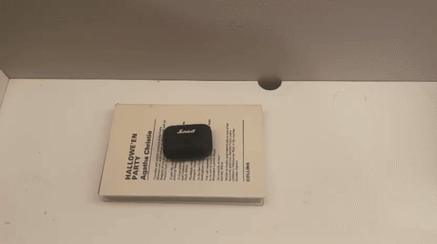
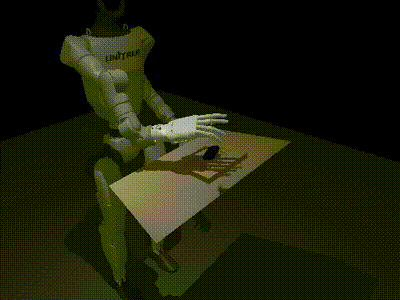
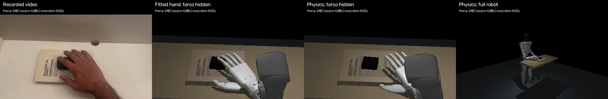

# Video-Guided Dexterous Manipulation

Transfer a recorded tabletop demonstration to a Unitree G1 with an Inspire
five-finger right hand in MuJoCo. The current example performs a retimed
pick-and-place task with contact feedback. Full-video imitation is incomplete.

## Demo

| Recorded demonstration | Physical transfer |
|---|---|
| [](examples/source-recording/book5.mp4) | [](examples/physics/physics.mp4) |

The robot moves a free case through motor-driven contact and holds its initial
orientation. Nominal lift is 49.5 mm; final position error is 13.9 mm against the
estimated destination. [Results, camera data and limitations](examples/physics/README.md)

## Pipeline

| Stage | Method | Output |
|---|---|---|
| Human hand | FastHaMeR / MANO on Core ML | Landmarks, mesh and wrist orientation; 683/748 detections |
| Scene | TAA, SAM3, DA3 and SAM 3D Objects | Estimated cameras, depth and textured geometry |
| Object motion | TrackCraft3R and rigid/image fitting | 740/748 pose candidates; 310 need review |
| Robot transfer | Contact-aware IK and MuJoCo force feedback | G1/Inspire motion, simulated cameras, states and commands |

Coverage is not pose accuracy. The published demo uses earlier estimated geometry. New full-video calibration
uses supplied dimensions; mass and friction remain estimated.
Lower-friction tests fail. The experimental GPU optimizer has not improved
rotation tracking. [Object-motion preview](examples/object-motion/object-motion.mp4)

## Full-video work

The new path preserves all 748 source frames and fits the initial gestures as
well as the manipulation. Camera calibration now uses the supplied book/case
dimensions. Full physical grasp and flip still fail.
[](examples/full-video/comparison.mp4)

[Steps, comparison metrics, compute and remaining work](docs/full-video.md)

## Setup

Apple Silicon macOS, Python 3.12, Git, uv and FFmpeg. The saved example runs on
CPU. Full hand extraction needs licensed MANO files; reconstruction also uses a
Linux NVIDIA GPU. Requirements and pinned dependencies are in the guides below.

```bash
git clone https://github.com/Dharun235/video-guided-dexterous-manipulation.git
cd video-guided-dexterous-manipulation
make setup
make test
make transfer
```

Outputs go to `runs/transfer/`. For another attempt, use
`make transfer OUTPUT=runs/transfer-02`. Models and generated runs stay outside Git.
The supplied calibration is specific to the included recording.

## Processing guides

1. [Hand extraction and camera calibration](docs/running.md)
2. [Scene reconstruction](docs/taa.md)
3. [Object-motion estimation](docs/object-motion.md)
4. [Upstream G1/Inspire retargeting](docs/retargeting.md)
5. [Physical execution, cameras and contact feedback](docs/physics.md)

[Experimental GPU physics refinement and failure report](docs/gpu-physics.md)

## Tasks

- [x] Include the recording, hand/scene estimates and source provenance.
- [x] Execute and measure a motor-driven transfer with a free object.
- [x] Export synchronized simulated images, joint states, commands and contacts.
- [x] Preserve all source frames in the new fit and verify command replay.
- [ ] Resolve hand/object depth, pose gaps and uncertain case orientation.
- [ ] Maintain grasp through rotation and validate full-motion transfer.

## Acknowledgements

Built on [TAA](https://github.com/brains-bots-n-behavior/track-articulate-act),
[TrackCraft3R](https://github.com/cvlab-kaist/TrackCraft3r),
[FastHaMeR](https://github.com/VimalMollyn/fasterhamer),
[humanoid-dexart-retarget](https://github.com/gtziafas/humanoid-dexart-retarget)
and [MuJoCo](https://github.com/google-deepmind/mujoco), with Unitree G1/Inspire assets.
[Full credits](docs/acknowledgements.md) · [Third-party notices](THIRD_PARTY_NOTICES.md)
