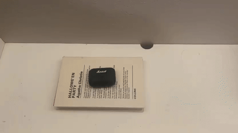

# Video-Guided Dexterous Manipulation

Transfer a recorded human hand motion to a Unitree G1 arm with a five-finger
Inspire right hand. The current pipeline extracts the complete recording,
estimates scene/camera geometry and fits robot joint targets. Physical grasp
execution is the next stage; policy training is outside the current scope.

## Source


[Full video](examples/source-recording/book5.mp4) · 748 frames. Audio removed;
video frames unchanged.

## Requirements and setup

Apple Silicon macOS, Python 3.12, Git, [uv](https://docs.astral.sh/uv/), FFmpeg
and graphics access. Hand extraction also requires your licensed MANO model.
Robot assets and inference models download during setup or first use.

```bash
git clone https://github.com/Dharun235/video-guided-dexterous-manipulation.git
cd video-guided-dexterous-manipulation
make setup
uv venv --python 3.12 .venv-book-reconstruction
uv pip install --python .venv-book-reconstruction/bin/python \
  -r reconstruction/requirements-book-mac.lock.txt
make test
```

Run the following commands from the project root. Choose new output folders
for later attempts. Full outputs remain local; selected previews are included.

## 1. Extract hand motion

```bash
.venv-book-reconstruction/bin/python -m reconstruction.video_hands \
  --video examples/source-recording/book5.mp4 --mano /path/to/MANO_RIGHT.pkl \
  --output runs/full-hands
```

FastHaMeR/Core ML estimates hand landmarks, mesh and wrist orientation for each
frame. Inspect `hand-overlay.mp4` and `coverage.json`. Missing detections remain
invalid rather than being filled with invented poses.



Current result: 683/748 frames detected (91.3%). This measures detection
coverage, not pose accuracy. [Missing intervals](examples/hand-extraction/coverage.json)

## 2. Build the scene and estimate camera poses

```bash
.venv-book-reconstruction/bin/python -m reconstruction.book_space build \
  runs/book5-space --video examples/source-recording/book5.mp4
.venv-book-reconstruction/bin/python -m reconstruction.video_cameras \
  --hands runs/full-hands --scene runs/book5-space --output runs/book5-cameras
```

The reviewed book plane supplies scale and camera geometry. SIFT matching and
RANSAC estimate camera movement across frames. The scene has approximate object
geometry; it does not yet recover the moving case's full trajectory.

## 3. Fit the G1 arm and Inspire hand

```bash
.venv-g1/bin/python -m humanoid.retarget_hand \
  --hands runs/full-hands --scene runs/book5-space \
  --cameras runs/book5-cameras/camera_poses.json --output runs/full-retarget
```

Bounded least squares fits seven arm and six hand controls to the estimated
landmarks, with finger-shape and temporal-continuity terms. The source timeline
is retained. Inspect named controls in `joint-map.json`, validity flags in
`retarget.npz` and residuals in `report.json`.

Current result: 683 frames fitted; mean wrist residual 11.7 mm and fingertip
residual 10.6 mm against inferred targets. These are not ground-truth accuracy
or physical grasp measurements. [Fit metrics](examples/hand-extraction/retarget-metrics.json)

## 4. Review the motion

```bash
.venv-g1/bin/python -m scripts.preview_hand_retarget \
  --hands runs/full-hands --retarget runs/full-retarget --output runs/fit-preview
```

[Source beside the fitted robot](examples/hand-extraction/kinematic-fit.mp4)

The preview imposes joint poses and leaves the object static. Missing detections
show a warning and the previous robot pose. Check orientation, finger shape,
reach, discontinuities and whether the full demonstrated motion is represented.

## 5. Verify physical execution — pending

Resolve detection gaps, refine hand–object interaction and execute through
MuJoCo motor controls. Check collision, sustained grasp, slip, release and
placement with the object free. The current preview does not establish these.
The pelvis is supported; walking and balance are outside scope.

## Project files

| Folder | Purpose |
|---|---|
| `reconstruction/` | Hand extraction, scene fitting and camera estimation |
| `humanoid/` | G1/Inspire model composition, joint fitting and geometry checks |
| `scripts/` | Robot setup and motion preview |
| `examples/` | Source recording and current results |
| `runs/` | Local outputs; excluded from Git |

[Output formats and assumptions](docs/running.md) ·
[Interaction-aware retargeting candidate](docs/retargeting.md)

## Acknowledgements

[MuJoCo](https://github.com/google-deepmind/mujoco),
[MuJoCo Menagerie](https://github.com/google-deepmind/mujoco_menagerie) and
[Unitree Robotics](https://github.com/unitreerobotics/xr_teleoperate) provide the
simulator and robot assets. Hand estimation uses
[HaMeR](https://github.com/geopavlakos/hamer),
[FastHaMeR](https://github.com/VimalMollyn/fasterhamer),
[FastHands](https://github.com/VimalMollyn/Mediapipe-Hands-PyTorch-CoreML),
[MANO](https://mano.is.tue.mpg.de/) and
[Core ML Tools](https://github.com/apple/coremltools).
[Third-party notices](THIRD_PARTY_NOTICES.md) record applicable terms.
