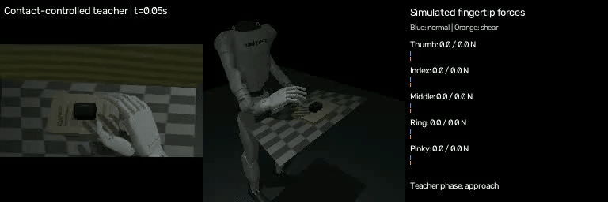

# Video-Guided Dexterous Manipulation

A recorded video of a hand moving a case off a book is used to build a robot
version of the task in MuJoCo, a physics simulator. The robot is a Unitree G1
with an Inspire five-finger right hand.

## Recorded input


[Full recorded video](examples/source-recording/book5.mp4) · Audio removed; video frames unchanged.

## Robot demonstration



The robot performs the same task with an adapted motion. The panels show two
simulation views and fingertip forces. This demonstration uses a programmed,
contact-controlled teacher; it is **not a learned-policy rollout**.

## How it works

1. Estimate the human hand motion and approximate scene from the recording.
2. Adapt that motion to the G1 arm and coupled fingers.
3. Use simulated fingertip forces to adjust grip while the free case moves
   through contact, friction and gravity.
4. Vary the starting state, case position, appearance and physical parameters;
   save verified images, joint angles, forces and motor commands.
5. Train SmolVLA, a model that chooses robot commands from images, instructions
   and robot state, then test it on scenes excluded from training.

## Tasks and progress

- [x] Record and publish the human task video.
- [x] Estimate the hand motion and approximate scene.
- [x] Retarget the motion to the G1/Inspire arm and hand.
- [x] Generate physical demonstrations with contact-based grip feedback.
- [x] Prepare and verify 96 episodes / 24,732 samples with separate train,
  validation and test groups (60/18/18 episodes).
- [x] Train and evaluate an initial SmolVLA baseline on the older dataset.
- [x] Publish a reproducible physics replay and sensor/action example.
- [ ] Train the vision-only baseline on the new dataset using a GPU.
- [ ] Train the tactile-aware model on the same data.
- [ ] Compare grasp stability, placement and forces on the locked test conditions.
- [ ] Improve placement and recovery based on validation failures.

The earlier baseline passed 1 of 7 unseen test cases; placement remains the main
weakness. New-dataset training has not started. RL is a possible later step,
not a completed result. [Measured results](docs/results.md) separate teacher
quality from policy performance.

## Reproduce the robot demonstration

Requires Python 3.12, Git, [uv](https://docs.astral.sh/uv/) and FFmpeg.
Tested on Apple Silicon macOS. A rented GPU and licensed hand-model files are
not needed for this replay.

```bash
git clone https://github.com/Dharun235/video-guided-dexterous-manipulation.git
cd video-guided-dexterous-manipulation
python3 -m scripts.setup_g1
python3 -m scripts.setup_book_g1
make test
.venv-g1/bin/python -m scripts.replay_example --output runs/example-replay
```

Open `runs/example-replay/execution.mp4` to see the result. The command replays
the supplied motor targets through physics and checks the robot motion, object
motion and fingertip forces against the recorded simulation. Use a new output
folder each time. This reproduces a demonstration; it does not train a policy
or automatically reconstruct a new video.

## Rebuild or train

- [Reconstruct from the supplied video](docs/running.md): requires licensed MANO
  assets and reviewed scene calibration.
- [Generate training data](docs/contact-data-preparation.md): explains variations,
  recovery starts, contact feedback and verification.
- [Train on a GPU](training/CONTACT_TRAINING.md): requires the prepared full dataset,
  provided separately; trained weights and full data are not stored in Git.
- [Inspect the example](examples/contact-demo/README.md) or [data format](docs/data-and-evaluation.md).

## Limits

All human motion comes from one recording. Scene scale, depth and hidden
geometry are estimates. The pelvis is fixed and supported; walking and balance
are not implemented. Touch is simulated, not a calibrated hardware sensor.
Original-scene policy comparisons use training-derived scenes, so they are not
independent generalization tests. Real-robot transfer is unproven.

[Design details](docs/approach.md) · [Code and asset licenses](THIRD_PARTY_NOTICES.md)
