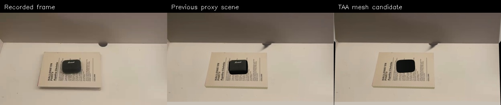

# Video-derived object geometry

TAA supplies segmentation, depth, single-view mesh reconstruction and mesh scale
alignment. Our adapter calibrates the case against the reviewed book plane and
exports a separate MuJoCo candidate. The existing scene remains available.

## Coverage

| Output | Coverage | Status |
|---|---|---|
| Right-hand estimates | 748 processed; 683 detections | Complete |
| SAM3 book and case masks | 748 frames each | Complete |
| DA3 depth and calibrated cameras | 748 frames; initial mesh check uses 14 | Complete |
| SAM 3D case geometry | First unobstructed frame | Candidate |
| Case translation and rotation through time | Overlapping full-rate tracking windows | Under review |
| Robot manipulation through motor/contact forces | Not verified yet | Pending |



[Full-recording segmentation preview](../examples/taa/full-video-masks.mp4).
Masks are model estimates; complete coverage does not establish boundary accuracy.

## Prepare frames

```bash
.venv-book-reconstruction/bin/python -m scripts.taa.prepare_video \
  --video examples/source-recording/book5.mp4 --output runs/taa-full
.venv-book-reconstruction/bin/python -m scripts.taa.prepare_video \
  --video examples/source-recording/book5.mp4 --stride 60 --output runs/taa-check
```

The first command writes all frames and records FPS-based timestamps. The second selects 14 frames,
including the last frame. Both save the source checksum and frame mapping.
Transfer each folder as an archive with Mac metadata excluded:
`COPYFILE_DISABLE=1 tar --no-xattrs -cf frames.tar -C runs taa-full taa-check`.

## GPU stages

The tested host is Linux with an RTX 6000 Ada, 48 GB VRAM. Model access requires
approved Hugging Face access and a private login on the host. Keep credentials
out of Git. Checkouts used:

| Repository | Revision |
|---|---|
| brains-bots-n-behavior/track-articulate-act | `ba06907ee29daaf6563e4e87d104e2d26d4327d1` |
| ByteDance-Seed/Depth-Anything-3 | `3d835ec1a5802d64a8b8b15f817a1ab54809bfe4` |
| facebookresearch/sam3 | `f1647e8d0c1d280991f4d1b7d974c2704537fe66` |
| facebookresearch/sam-3d-objects | `f91db411c50efee93d8db7aeb323885650f6f722` |

Place these checkouts at `/workspace/taa-work/{TAA,DA3,sam3,sam3d}`.
Use each project's installation instructions for DA3 and SAM3 in `env-depth`.
Our [SAM 3D setup script](../scripts/taa/setup_sam3d.sh) creates `env-sam3d`;
it assumes the checkouts, uv and CUDA toolkit are already present. The two
`scripts/taa/*-linux-observed.txt` files record the installed package versions;
editable paths refer to the checkouts on that host.

Copy `scripts/taa/segment_video.py` into `/workspace/taa-work/`, then run:

```bash
cd /workspace/taa-work
export HF_HOME=/workspace/hf-cache
env-depth/bin/python TAA/scripts/00_da3_depth_cameras.py \
  --scene-dir taa-check --da3-root DA3 \
  --model-name depth-anything/DA3NESTED-GIANT-LARGE
env-depth/bin/python segment_video.py \
  --scene-dir taa-check --prompts-json taa-check/prompts.json --version sam3
env-depth/bin/python segment_video.py \
  --scene-dir taa-full --prompts-json taa-full/prompts.json --version sam3
CONDA_PREFIX=/usr/local/cuda env-sam3d/bin/python TAA/scripts/03_sam3d_reconstruct.py \
  --scene-dir taa-check --sam3d-repo /workspace/taa-work/sam3d \
  --checkpoint-tag hf/checkpoints --labels case --candidate-idx 0 \
  --pointmap-source moge --save-input --no-cudnn
env-sam3d/bin/python TAA/scripts/04_sacle_mesh.py \
  --scene-dir taa-check --labels case --candidate-idx 0
```

The wrapper enables CPU offload for full-video segmentation without editing TAA.
The selected SAM 3D release does not accept TAA's extra DA3 point-map arguments,
so reconstruction uses MoGe and stage 04 aligns against DA3 afterward. Upstream
reads `CONDA_PREFIX` as its CUDA location; the environment itself uses uv.
Keep new attempts in new scene folders. TAA's filename `04_sacle_mesh.py` is
intentional here. Download outputs before terminating temporary GPU storage.

## MuJoCo candidate

Copy the GPU output folder back to the Mac, then run:

```bash
.venv-book-reconstruction/bin/python -m reconstruction.taa_scene \
  --taa runs/taa-check --scene runs/book5-space --output runs/taa-candidate
.venv-g1/bin/python -m scripts.taa.check_scene \
  --scene runs/taa-candidate/scene.xml
```

The adapter applies TAA's mesh/pose convention, fits the first-frame silhouette,
calibrates scale with the estimated 198 × 129 × 18 mm book, and constrains the
initial case to the book surface. The original mesh has 520,252 faces; the
simulation visual uses 80,000 faces and collision uses a convex hull. Mass
55 g and friction 0.7 remain assumptions. Appearance currently uses a plain
material rather than the recorded logo/texture.

The supported first-frame outline fit has 0.43 px support residual. This is
calibration on the same mask, not independent reconstruction accuracy. Estimated
case extent is 59.1 × 46.8 × 35.6 mm; hidden thickness remains uncertain.
After five seconds under gravity, linear speed is 0.70 mm/s and angular speed
0.012 rad/s, with four final contacts and maximum penetration 0.84 mm. The case
rocks and settles about 6 mm sideways from its initial position. This checks
basic collision behaviour; it does not establish an accurate grasp model.

## Remaining work

Review [moving-case pose estimates](object-motion.md) and their missing intervals.
Use the hand and object trajectories together in retargeting, then verify an
actuator-driven grasp with the object free. TAA's human-hand replay is not used
as evidence of a successful G1/Inspire grasp.
