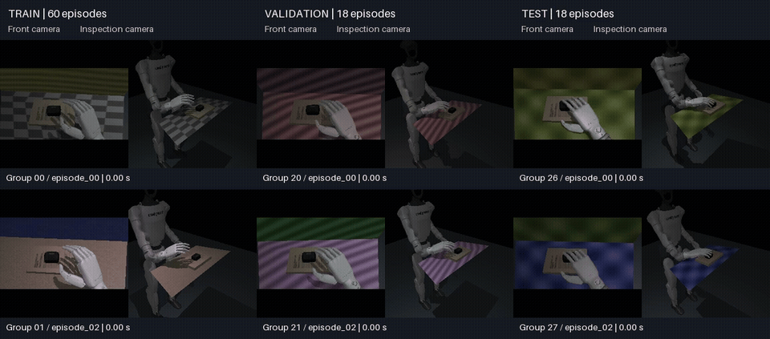

# Dataset preview



[Video](splits.mp4) · [Still image](splits.jpg) · [Episode selection](selection.json)

Columns are training, validation and test. Rows show two different physical
groups per split. Each pair shows the recorded front and inspection images,
without another simulation render. Camera images are 256 × 256 in the dataset
and resized to 192 × 192 in the video grid.

Selection uses the first two physical groups in each split: the first visual
variant of the first group and the last variant of the second. This is a small
sample of the accepted reference data, not a policy benchmark or a full view
of variation coverage. Shorter episodes hold their final frame. Playback uses
recorded time, sampled at 8 fps in the MP4 and 6 fps in the GIF.

To build a new preview, supply the full verified dataset, FFmpeg and a Python
environment with Pillow installed. Use a new output directory:

```bash
python -m scripts.preview_data_splits --dataset /path/to/dataset \
  --output runs/data-preview
```

The script saves the selected episode identifiers, dataset manifest checksum
and preview timing in `selection.json`. It leaves the dataset unchanged.
