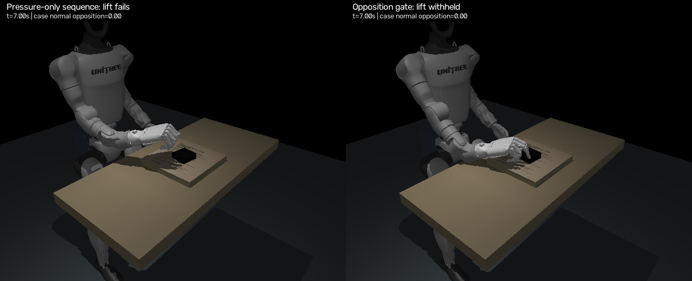

# Grasp verification

[](verification.mp4)

None of the four candidates passes. This is a failed grasp check, not a working
manipulation demonstration. The case is a free 6 × 6 × 2 cm rigid box with an
assumed mass of 55 g. No attachment, object actuator or external object force is used.

The left panel executes closure and a 50 mm hand lift without a contact gate.
The best case movement is 5.27 mm. The right panel requires thumb and index/middle
contacts on the same external body, with opposing normal directions and at least
0.3 N resultant normal force per finger for 150 ms. None establishes that contact,
so the controller withholds the lift. Pressure on the top surface alone is not
an opposing grasp.

Acceptance requires a 25 mm case lift supported by normal opposition for 0.5 s,
with less than 10 mm translation and 10 degrees of rotation relative to the hand.
The final 0.5 s must remain supported, without a contact-loss abort. No candidate reaches a supported interval, so slip is
unavailable, not reported as zero. The contact gate uses no predefined case ID;
case identity is used only for evaluation.

After [robot setup](../../docs/running.md) and the measured-scene steps in
[the full-video guide](../../docs/full-video.md):

```bash
.venv-g1/bin/python -m video_g1.grasp_verify \
  --scene runs/full-video-scene \
  --candidates examples/grasp-verification/candidates.json \
  --output runs/grasp-verification
```

The saved controls avoid repeating the geometric search. For new proposals,
`video_g1.grasp_search` uses bounded contact IK followed by Powell refinement and
physical verification. Its posture prior comes from the recorded hand; proposed
side contacts are planning assumptions, not recorded tactile observations.

`report.json` contains all eight runs: four candidates with and without the gate.
`replay.npz` and `gated.npz` contain the displayed candidate's states, normal
opposition, external forces and every executed control. Tests separately confirm
that opposed contacts are detected, parallel pressure is rejected and contacts on
different external bodies cannot be combined into a grasp.

The current controller prevents an unsupported lift. Secure grasping, rotation
and release remain unresolved. No GPU or learned policy is used in this check.
