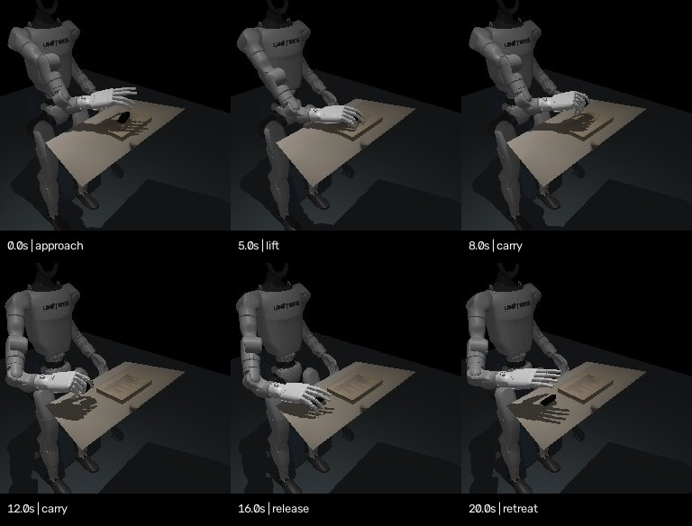

# Recorded task to physical transfer

[Watch the physical rollout](physics.mp4)

The G1/Inspire right hand approaches, grasps, lifts, carries and releases a free
case. Source recording: an iPhone 14 held in the author's left hand while the
right hand manipulated the case. The original video supplies the grasp seed,
initial object pose, lift reference and estimated destination.

| Check | Nominal result |
|---|---|
| Maximum lift above initial case centre | 49.5 mm |
| Longest opposing-case-contact interval while lifted over 25 mm | 5.74 s |
| Final position error against the estimated destination | 13.9 mm |
| Maximum case translation relative to hand during lift/carry | 28.7 mm |
| Release and final settling | Pass |

The slip statistic shows that the grasp is not rigidly fixed. No weld or external
object force is used. The object pose is set at reset only; subsequent motion
comes from motor-driven contact and gravity. The robot is supported with
bias-force compensation. Estimated collision geometry, mass and friction remain
assumptions.

This is a 21 s translation-task adaptation, not exact reproduction of the full
12.5 s video. Phase timings and clearance margins are prescribed; the initial
case orientation is held instead of reproducing the uncertain flip. The final
XY target comes from review-flagged video estimates. Physical success in this
model does not resolve that visual uncertainty.

## Checks and failures

| Configuration | Outcome | Lift | Final position error |
|---|---|---|---|
| Nominal contact feedback | Pass | 49.5 mm | 13.9 mm |
| Case mass +20% | Pass | 49.3 mm | 15.0 mm |
| All sliding friction ×0.7 | Fail | 4.8 mm | 179.9 mm |
| Finger-force adjustment disabled; contact gate retained | Fail | No lift | 175.6 mm |
| Optional upstream MPC during carry | Pass | 51.5 mm | 12.3 mm |

These are individual deterministic configuration checks, not a measured success
rate. MPC has a shorter longest contact-supported lift interval (1.8 s versus
5.74 s) and takes longer to compute, so it is optional. Earlier MPC acquisition
trials also failed. Robustness and full-motion fidelity remain open.
[Full reports](evaluation.json)

## Camera/state/action data

[Download the observation episode](observations.zip): 210 synchronized rows at
10 Hz, with 256 × 256 images from two cameras, 19 joint positions/velocities,
13 position commands, five normal/shear contact pairs and logged feedforward
torques. The archive contains `episode.npz`, `manifest.json`, `validation.json`
and relative image folders. All image/array counts and dimensions were checked.
This is simulated diagnostic data; it is not marked ready for policy training.

`rollout.npz` retains physics states at 50 Hz. `schema.json` names the channels.
`hand-seed.npz` and `calibration/` contain the compact, derived inputs needed to
run this example; no MANO model files or neural weights are included.
[Provenance](provenance.json) · [Execution report](report.json) ·
[Commands and control design](../../docs/physics.md)
