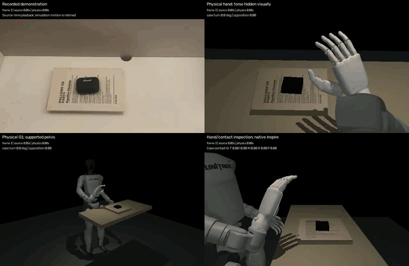

# Complete physical sequence

All 748 source frames are retained. The robot performs initial palm/finger
motions, grasps, transports and turns the free case, places and releases it,
then follows the final wrist/finger gestures. The fingers approach loosely open;
all five carry measured case contact during the scored turn. The 12.5 s recording is retimed to
70.5 s of simulation; this preview follows source time and labels both clocks.

The nominal task check and both ±3 mm case-position checks pass. Motor-only
replay matches all 748 saved states exactly across 70,490 arm/hand/waist commands.
Before contact, approach flexion stays below 0.26 rad; the earlier parked-finger
fist is removed. Each finger has case-specific load above 0.05 N in all scored
turn samples. The contact view labels T/I/M/R/P forces in newtons.
There are no object forces, attachments or object-pose playback. The pelvis is
supported and robot-only bias compensation is enabled.

[Methods, commands, compute and limitations](../../docs/full-sequence.md) ·
[Nominal results](report.json) · [Controlled checks](sensitivity.json) ·
[Replay check](replay-check.json) · [Wall times](pipeline.json)

`reference.npz` stores proposals and preserved source-observation flags.
`rollout.npz` stores actual physical states, motor commands and contact signals.
`failure-summary.json` retains the release and approach failures that motivated
the corrections. Stage runtime files preserve their generating input and source
hashes; `evaluation-provenance.json` identifies the saved arrays and scoring
implementation. `SHA256SUMS` covers this published bundle.

This is a reviewed, task-specific adaptation with estimated physical parameters,
not exact hidden-pose reconstruction or demonstrated performance on arbitrary
videos. No VLA/RL training or real-robot execution is claimed.
